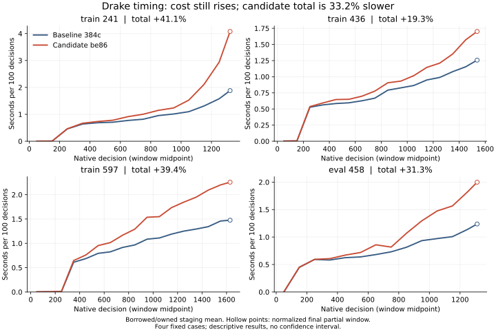

# Drake history comparison, 2026-11-08

The four fixed cases preserve every terminal result and final-state hash, but
the immutable-history candidate is slower in every case. Total recorded
decision time increases 37.3%. This does not establish the flat-cost improvement
required by #474; PR #583 remains draft and the issue remains open.

The table sums native decision-window time, then averages the borrowed and
owned staging variants of each identical game. It excludes process startup.

| Fixed case | Baseline seconds | Candidate seconds | Time increase |
| --- | ---: | ---: | ---: |
| train 241 | 16.086 | 21.856 | 35.9% |
| train 436 | 14.833 | 19.347 | 30.4% |
| train 597 | 20.505 | 29.964 | 46.1% |
| eval 458 | 12.468 | 16.539 | 32.6% |
| Sum | 63.892 | 87.706 | 37.3% |

All 100-decision windows are retained. The final partial window is normalized
only for plotting; totals use its actual elapsed time. For the owned candidate,
the windows containing 50%, 70%, and 90% of completed decisions cost:

| Case | 50% seconds | 70% seconds | 90% seconds |
| --- | ---: | ---: | ---: |
| train 241 | 1.587 | 1.823 | 4.622 |
| train 436 | 0.949 | 1.541 | 2.269 |
| train 597 | 1.834 | 2.587 | 3.084 |
| eval 458 | 0.986 | 1.833 | 2.014 |

The completed-work comparison used the same two qualification cases, exact
Windows binaries and runtime inputs on both PCs. Serial/two-worker batch times
were 168.601/83.945 seconds on Jack's PC and 175.157/85.250 on Haley. Both chose
two workers and reproduced identical terminal hashes. The guarded launcher
selected Jack's PC, workers 0 and 2 with SMT siblings reserved on 0-3, for the
remaining cases. Other research claims stayed outside those cores. There were
40 bounded engineering games across qualification and comparison, no paid
allocation, and no training or playing-strength measurement. Haley drained its
descendants, removed its logon-local mapping and released its reservation.

Baseline native source: `384c8a4e5103f40384928adb69720268e4ecd8cb`.
Candidate native source: `17856aa9b6e6c116440b64acab0dcbfe4306e03a`.
Runner source: `15ccba4ce346d7eadc85ea34d013b6840de1d94a`.
The retained plan pins both binaries, all input bytes, seed 1, the exact cases
and guarded commands. Serial qualification is not counted as an independent
statistical sample. These are descriptive results from four fixed cases, with
no confidence interval or general performance claim.

Primary evidence directory:
`D:/mtg-kernel-history474-timing-evidence-20261108-01`.
`comparison-v2/comparison.json` SHA-256:
`b084f76ba4742e2b796f20cf71b8d3917f4de3c555e2bdbf5b7959454357873a`.
`selection-v2.json` SHA-256:
`ccce57d5e79af2fd7dd79b6c860fe1e16af6feea857f5d4709e3b24e65aa1a8c`.
`result-v2/` contains the complete-window CSV, numeric summary and inspected
`history-window-comparison.png`. No bulk artifacts are committed.

Next: diagnose the remaining growing work and the regression against these
retained receipts before changing or measuring another candidate. The baseline,
candidate, failed attempts and completed comparison remain intact.

## Logical-index follow-up

A separate matched comparison of candidate
`7b2576e7f2edb5b254b65cb834b12f7eda62f38c` against the same baseline source
preserved every outcome and final-state receipt but still failed #474.
Summing each game's windows and averaging its borrowed and owned staging modes
gives:

| Fixed case | Baseline seconds | Candidate seconds | Time increase |
| --- | ---: | ---: | ---: |
| train 241 | 21.275 | 27.944 | 31.3% |
| train 436 | 19.401 | 23.329 | 20.3% |
| train 597 | 33.090 | 37.527 | 13.4% |
| eval 458 | 18.733 | 21.191 | 13.1% |
| Sum of staging means | 92.499 | 109.991 | 18.9% |

The unaveraged sum across both modes is 184.997226 versus 219.982786 seconds,
an increase of 18.9114%. This is a separate comparison, so the change from
the earlier 37.3% regression is not itself a controlled effect estimate.
Late-game cost still grows: train 597's owned 1501-1600 window costs 4.4094
seconds per 100 decisions for the candidate, versus 2.8952 for the baseline.
These four fixed cases do not provide a general performance estimate or a
confidence interval.

The retained comparison is
`D:/mtg-kernel-history474-logical-qualification-20261108-01/timing-7b-qualification/comparison/comparison.json`,
SHA-256 `5e409f93c7050244112c540f2f362876e8fc6e8a11ded6099145be9f40120d01`.
Its plan SHA-256 is
`0072669a2cdc6c6474af9deb45f1a3ed031626e70002cc0e38585c841d4df457`.
All original windows and both earlier comparison artifacts remain intact.

The next source candidate adds bounded proof memoization for immutable Drake
rows and avoids expanding already-proved nested records during checkpoint
serialization. Source `89751ff88e8c22002e385aafcd3abf163fa595d8` has been
composed with main `40e278bd73b09264d9b363bdc81ce63f92a28b37`. Source review
found no blocker in allocation identity, exact prefix checks, or legacy
serialization fallback. Native correctness, timing and current CI remain
pending. Neither this candidate nor the logical-index repair establishes flat
per-decision cost; PR #583 and issue #474 remain open.

The retained `7b2576e7` train 436 diagnostic recorded 4.173 ms in 912
Faebloom validation spans around decisions 301-400 in owned staging and
21.489 ms in 900 spans around decisions 1401-1500, grouped by native apply
markers. The journal scan now skips histories whose event index proves they
have no Faebloom journal rows. Trigger-log, live-stack and pending checks
still run. These small inclusive spans motivate the guard. The current
candidate had no measured timing result at that point.

Diagnostic log: `timing-7b-qualification/diagnostic-train436-001/phase.stderr.log`
under the logical qualification evidence directory above, SHA-256
`a94e7697fa06bc5251b70df857842503706dc284affa8fce3f0fd618888d1c43`.

## November 10 matched follow-up

Candidate `be8611b12e4b3aaff29e95e0e6c444871e950eb8` preserved every
outcome and final-state receipt against baseline
`384c8a4e5103f40384928adb69720268e4ecd8cb`, but failed #474's flat-cost
criterion. Summed decision time was 33.2203% higher, and all four cases
continued to grow more expensive late in the game.

| Fixed case | Baseline seconds | Candidate seconds | Time increase |
| --- | ---: | ---: | ---: |
| train 241 | 10.866 | 15.327 | 41.1% |
| train 436 | 11.170 | 13.325 | 19.3% |
| train 597 | 14.382 | 20.047 | 39.4% |
| eval 458 | 9.443 | 12.398 | 31.3% |
| Sum of staging means | 45.862 | 61.097 | 33.2% |

Each table row sums the actual decision windows and averages borrowed and
owned staging. The unaveraged totals are 91.7237644 and 122.1946904 seconds.
The plot uses all 244 windows, averaged only across the two staging modes.
Hollow final points normalize a partial window to 100 decisions; they are
not full-window observations. These are descriptive results from four fixed
cases, with no confidence interval or general performance estimate. The
earlier comparisons remain separate measurements, so their percentages
cannot establish an improvement or regression between candidate revisions.

Fresh completed-work qualification ran the same two cases with one worker
and then two: 122.5279 versus 63.2160 seconds, with identical terminal hashes.
The supported selector chose two desktop P cores, 0 and 2, reserving SMT
siblings 0-3. The remaining comparison completed in 78.1844 seconds. The
launcher enforced 61 GiB admission, a 60 GiB live floor, 128 MiB per stage,
1800 seconds per job and 7200 seconds per batch. No other desktop native
build or timing ran concurrently. Haley was checked and ineligible because
its sole volume was below 60 GiB; its live T4 claim was preserved. RunPod's
read-only census found no pods, and no paid allocation was authorized.

Both executable files and timed outputs were on the same desktop SSD.
Compile-time fixture paths were on D for the baseline and E for the candidate;
all 81 input files matched byte for byte and were loaded before the reported
inner decision windows. This path difference remains part of the record.
The source-only collector fixture repair had passed 1/1, complementing the
four compatible preceding native checks. No performance acceptance or
production adoption follows from those correctness passes.

Primary sealed evidence is
`E:/codex-drake474-matched-be86-20261110`, with a verified second copy retained
under the same directory name on D. Comparison SHA-256:
`606b9a89b45238989d0bdc6fe471ee5130942b9ce0dc13b4e1d526c24d7173c2`.
Plan SHA-256:
`2a84963ddc90160e123b3d3e4c11968836f108193b24502cd60917907e300757`.
Qualification SHA-256:
`988a677fc0f56814781d51aeef47e96a66713ac85161cf79ee5281a18131a4fd`.
Selection SHA-256:
`a316d01950e6b9ef3faa8e37ee83e2ac036fe5f5fd7825ef3bc64f3f7f65cfaf`.
The 69-file verified custody receipt SHA-256 is
`b90c984cc5de4c757b03d64faf2a6386476babe4c6cf16c8468b28b1dac824bd`.
The figure, calculation and renderer are retained separately under
`E:/codex-drake474-report-20261110` with matching copies on D.

The preceding six-file disposal removed only approved uncited Cargo
intermediates, preserving every executable, log and evidence record.
`drake474-20261110-PRUNE.json` records the planned paths and regeneration
commands; `drake474-20261110-cleanup.json` records the observed removal.
All failed attempts and earlier timing results remain retained.

The next source successor, `61ad66ecb`, makes relation validation sparse only
after an accepted immutable public prefix. It retains the ordered positions
of private journal rows, rechecks those rows and every new row, and projects
new enclosing intervals onto their positions. Proven old coverage starts at
one; backward overlap and duplicate-reference checks remain active. Live
stack, held-trigger and Time Stop checks still run. Edited, legacy and
memo-free histories retain the dense relation pass. Replay, serialization
and digest semantics are unchanged.

The retained older profile identifies replay as a growing inclusive span;
it does not isolate this loop's runtime in `be8611b12`. The new native fixture
uses actual paid Drake combat, checks historical row-visit counts, and compares
dense refusal verdicts for overlapping enclosures, duplicate publication and
reintroduced live/held rows. Root and independent source review found no
blocker. Pinned Rust 1.94.1 formatting passed, receipt SHA-256
`1109ac88ed313ee47aea36253f84809256e60e472c70e56267a88a7d1027e8e8`.
Native correctness and timing of this successor remain pending. The measured
33.2203% regression belongs to `be8611b12`, not to this unmeasured successor.
PR #583 and issue #474 remain open.
