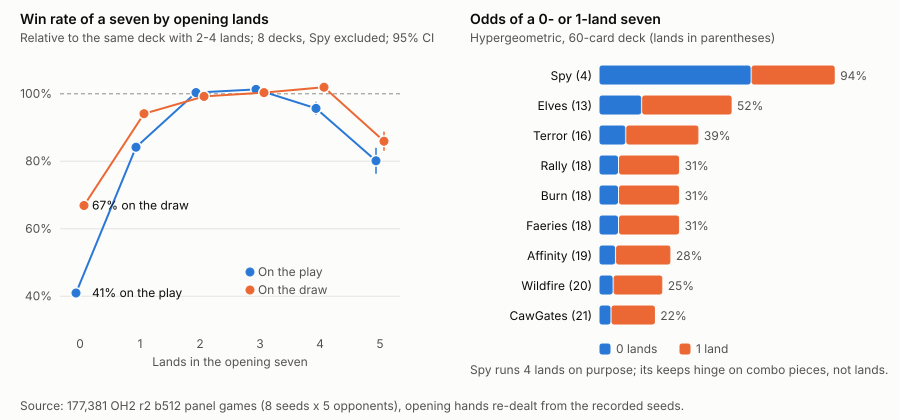

# Forced-keep noise in default Pauper games (v1)

Desk measurement on existing records only, 2026-10-30. Default Pauper games
have no mulligans: both seats keep their first seven (`keep_seven_v2`). This
memo measures how much that costs. The design for an opt-in fix is
`docs/design/pauper_london_mulligans_v1.md`.

## Data

- 177,381 games: every game of every Bo3 match in the 40 OH2 r2 b512 panels
  (seeds s1-s8, each against Ha, Hb, R3, T1 and TP; 1,944 matches per panel).
  No game was sideboarded, so every game used the registered mainboards.
- Opening hands are not stored in the records. They were re-dealt from each
  game's recorded environment seed, game index, starting player and per-seat
  mainboards with the same `HumanOpeningV1` deal the panels used, by
  `mtg-kernel/examples/opening_hand_census_v1.rs` (built on HaleysPC).
- Checks:
  - observed land counts match the hypergeometric for every deck (Elves
    0-1 lands: 52.6% observed, 52.4% expected; CawGates 21.7% and 21.7%);
  - the deal-to-outcome link is strong where it should be (below).
- Inputs: archived match JSONs in
  `E:/d-lane-moves-20261026/oh2-20261024/_archives/eval__r2-s*-b512-vs-*.tar.zst`,
  joined to each panel's `rows.jsonl` by match sha256. Extracted games:
  sha256 d08505f5; dealt hands: 85c15a1e.
- Intervals are 95%, from a bootstrap over matches.

## Findings

1. **Zero-land sevens decide games; one-land sevens mostly do not.**
   - Relative to the same deck with 2-4 lands, a 0-land seven wins 41% as
     often on the play and 67% on the draw (8 decks, Spy excluded).
   - A 1-land seven wins 84% as often on the play and 94% on the draw.
     These decks have low curves and many cantrips, so "0-1 lands" overstates
     the problem. The crude 0-1 or 6-7 land bucket shows only a small gap:
     those seats win 47.4% against 51.0% for the rest.
   - Six-land and seven-land sevens are rare (under 0.6% of seats in any deck).
2. **How often it happens.** 7.7% of non-Spy seats keep a 0-land seven, and
   13.4% of games have at least one.
3. **Share of outcomes fixed by the deal.** For each deck and land count, the
   wins a hand loses against that deck's normal hands are counted as decided
   by the deal ("pinned").
   - 8.6% of seat outcomes are pinned (CI 8.1-9.0%) and 17.1% of games
     (CI 16.2-17.9%). Zero-land sevens alone account for 3.0 points per seat.
   - A skill edge is invisible in a pinned game, so it shrinks by that share.
     To rate a bot to the same precision takes **1.46x the games** (CI
     1.42-1.48).
   - Mulligans recover only part of this, because a mulligan to six has its
     own cost. If that cost pins 10-20% of a game (an assumption, not
     measured here), good mulligans would cut the inflation to about
     1.18-1.31x.
4. **The focal b512 policy** wins 67.6% of its games with a normal seven and
   63.3% with a 0-1 or 6-7 land seven.

| Deck | Lands | P(0 lands) | P(0-1 lands) | Win rate, 0 lands | Win rate, 1 land | Win rate, 2-4 lands |
|---|---:|---:|---:|---:|---:|---:|
| Wildfire | 20 | 5% | 25% | 26% | 29% | 39% |
| Rally | 18 | 7% | 31% | 54% | 81% | 83% |
| Affinity | 19 | 6% | 28% | 24% | 40% | 53% |
| Elves | 13 | 16% | 52% | 31% | 56% | 60% |
| Spy | 4 | 60% | 94% | 27% | 32% | 36% |
| Burn | 18 | 7% | 31% | 32% | 51% | 52% |
| Terror | 16 | 10% | 39% | 42% | 68% | 68% |
| CawGates | 21 | 4% | 22% | 26% | 32% | 41% |
| Faeries | 18 | 7% | 31% | 25% | 45% | 48% |

Win rates are the hand holder's, across all seats and opponents in these
panels; P columns are hypergeometric for a 60-card deck. The rough figure
of 25 to 48% for 14 to 20 lands matches: 22% (21 lands) to 39% (16 lands),
with Elves at 52% (13) and Spy at 94% (4). Spy runs 4 lands on purpose, so
its mulligan question is combo pieces, not lands; its land-count pinning is
in the totals above but its keeps need a different read.

## What it means for EX1

- EX1's primary endpoint is Spy line resolution, tested by a paired exact
  McNemar test over identical evaluation cases (same seeds) for X and O.
  Both arms get the same deal in each pair, so hand luck cancels within a
  pair. It does not add variance to that paired test; it can only lower the
  number of cases where either arm has a live line.
- Turning mulligans on inside EX1 would break that pairing, since the arms
  would mulligan differently. EX1 is frozen in any case.

## Limits

- The panels are b512 against five legacy policies; a stronger or weaker
  pilot may convert bad hands differently.
- Pinning is measured on land counts only. Other hand-quality factors (color,
  curve, key cards) add more deal noise, so 17% is a lower bound on what
  the deal decides; mulligans can address part of that too.
- Starting player is not random within a Bo3 (the loser chooses), so the
  play/draw split is descriptive.

Reproduce: `tools/mulligan_noise/` (extract, deal, pinning, chart).
