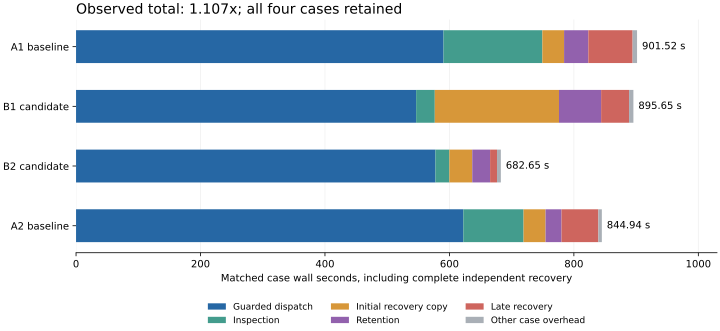

# Matched training I/O speedup results

All four ABBA cases completed on October 11, 2026: **648 updates and 6,480 games**, with exact output parity and independent D/E recovery. The observed **recovery-inclusive total speedup is 1.106543x**, or **9.63% less time**. Baseline averaged **873.233 seconds** per 162-update block; candidate averaged **789.154 seconds**.

Adjacent pair ratios are **1.006552x** and **1.237732x**. Every completed case is retained. This is a combined-package observation from an interrupted comparison, with two measurement sessions and a third coordinator session that ran no case. Storage, cache and background-work conditions may have changed across the gap. It is not an estimate of an individual patch effect or an uninterrupted isolated production gain.

## Every case and both pairs

Seconds. Guarded dispatch includes native execution and archive work. The phase columns are sequential; child/archive/exposure timers below are nested diagnostics. Matched wall subtracts only the separately timed first-case allocation audit. Small controller envelopes, receipt self-copy and final SHA reads are included in the totals.

| Case | Dispatch | Inspect | Initial recovery | Retain | Late recovery | Matched total | Raw total |
|---|---:|---:|---:|---:|---:|---:|---:|
| A1 baseline | 590.469 | 158.888 | 34.906 | 38.956 | 71.189 | 901.521 | 902.696 |
| B1 candidate | 546.515 | 29.986 | 199.591 | 67.707 | 44.884 | 895.653 | 895.653 |
| B2 candidate | 577.467 | 22.467 | 36.777 | 28.673 | 11.119 | 682.655 | 682.655 |
| A2 baseline | 622.321 | 96.830 | 35.351 | 25.632 | 59.237 | 844.944 | 844.944 |

A1/B1: 901.521 / 895.653 = **1.006552x**. A2/B2: 844.944 / 682.655 = **1.237732x**. The total ratio is the sum of both baseline walls divided by the sum of both candidate walls, not an average of pair ratios. Raw case-wall ratio is 1.107287x; the declared matched metric removes only the first-case allocation audit.

## Where time changed

Means across the two cases of each variant. Rows at different nesting levels must not be added.

| Region | Baseline mean s | Candidate mean s | Ratio |
|---|---:|---:|---:|
| Full matched wall | 873.233 | 789.154 | 1.106543x |
| Guarded dispatch | 606.395 | 561.991 | 1.079013x |
| Native child, inside dispatch | 385.319 | 343.128 | 1.122960x |
| Native archive, inside dispatch | 82.889 | 82.487 | 1.004876x |
| Inspection | 127.859 | 26.226 | 4.875210x |
| Exposure, inside inspection | 108.169 | 5.018 | 21.555025x |
| Initial recovery copy | 35.128 | 118.184 | 0.297236x |
| Retention | 32.294 | 48.190 | 0.670145x |
| Late recovery | 65.213 | 28.001 | 2.328940x |
| Late receipt self-copy | 1.196 | 1.432 | 0.835548x |

The largest observed reduction is inspection and exposure processing; late recovery also fell. Candidate B1 initial recovery took 199.591 seconds versus 36.777 seconds in B2, and retention took 67.707 versus 28.673 seconds. This variability is included in the total and limits generalization. No timing outlier was excluded.

The package reuses SHA-bound exposure projections while rehashing source trajectories, reduces duplicate checkpoint validation during the existing typed continuation read, reuses publication receipts, and reads pinned trajectories in parallel while preserving ordered numeric updates. The STORE ZIP batches the complete late controller/maintenance metadata inventory. Native archive and raw trajectory recovery continue through their existing independent copy path. Candidate recovery additionally includes its pinned exposure-input sidecar, so payload sizes need not match. Individual causal effects cannot be isolated by this comparison.

## Verification and placement

Both frozen variants used eight collection/preparation workers on even CPUs 0 through 14. All four actual native affinity observations matched 21845. Fresh serial/increasing-worker qualifications and transport qualification selected this allocation. Desktop was eligible after guarded admission; Haley lacked the required 76 GiB free headroom and RunPod inventory returned 403 with no paid authority. Healthy foreign reservations and shared CI/FDN claims were preserved.

The analyzer verified full ordered trajectories, model and optimizer fingerprints, checkpoints and ledger; all 162 deterministic update outputs per case; unchanged exposure and embedding gates; equal native member coverage except the separately pinned and recovered candidate exposure sidecar; source and independent destination SHA for every recovered member; physical allocation reconciliation; and both failed-prefix provenance chains. Update comparisons exclude only enumerated timing/worker telemetry. Unknown scientific fields, paths, exact numbers and deterministic preparation counters remain compared. See the full analysis for every excluded field.

Both release builds and all 24 affected native tests passed. Focused Python validation passed 62 tests with five platform/privilege skips. Frozen baseline `b3bd1c1c0d7b5b6766359a3901549de768bcc175` includes PR200; frozen candidate `172ccb3c818a96f082f2cab44c570134a0b21ee3` contains the production package. Later commits add harness, analyzer and reporting repairs only.

## Complete elapsed accounting

Raw overall elapsed is **29,034.638063 seconds (8h 03m 55s)** from 05:47:03.374343 to 13:50:58.012406 UTC. It includes all three coordinator sessions and both stopped gaps. No native case was interrupted or rerun. The original coordinator timed out before case 3; the first continuation refused an unknown reservation state during release, also before case 3. The second continuation preserved cases 1/2 and ran only cases 3/4.

| Nonoverlapping interval | Seconds |
|---|---:|
| Four raw case walls | 3,325.948621 |
| Four successful measured admission waits | 3,421.180540 |
| Original failed-admission UTC proxy | 7,200.302812 |
| First continuation resume-to-terminal UTC proxy | 13,856.676248 |
| Two stopped gaps | 1,229.420778 |
| Remaining coordinator overhead | 1.109064 |

Matched case walls sum to 3,324.774104 seconds. Only the first-case 1.174517-second allocation audit is removed. Failed intervals are UTC proxies including pre-wait work, not measured monotonic queue durations. Final coordinator-state independent copy and this analysis occur after the finished coordinator clock. Raw campaign elapsed is reported for transparency and is not a variant speedup ratio.

Canonical dispatch generations were 466, 467, 472 and 473. Maintenance before/after highest generations were 466/466, 467/468, 472/472 and 473/473. Generation 468 Spellbench began during B1 maintenance. These observations do not rule out shared-slot or unreserved background work and never exclude a case. Failed Spellbench guard identities were already absent and its reservation released when cleanup was inspected; Codex performed no termination or reservation mutation.

## Durable evidence

Full verified analysis: `D:/training-io-speedups-20261010/desktop/formal/analysis-20261011T1400/analysis.json`, SHA-256 `53a1fea0481f47f63965eb15233c3323952a147bfc194795e643e8b84cf95fce`. Independent exact-byte copy: `E:/training-io-speedups-20261010/analysis/formal-20261011T1400/analysis.json`.

Recovery receipt SHA-256 `2d5c7112654b2c8ec0ae169acaa88122a4e50f02ad7fa87220307396354e541c` matches on D and E; every output was fsynced before full readback. [Compact results](compact-analysis.json) and [all case timings](cases.csv) are committed here. The complete analysis retains all input/source pins, member and update hashes, physical allocations and predecessor chains. Bulk evidence stays outside Git. Prior PR200/PR140 and D/E training-speedups-20261009 evidence remain immutable.

This engineering result establishes neither playing strength nor holdout improvement.
